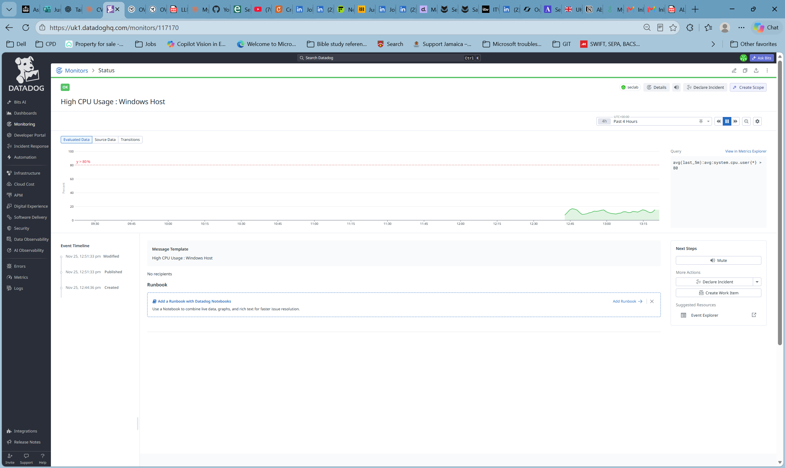
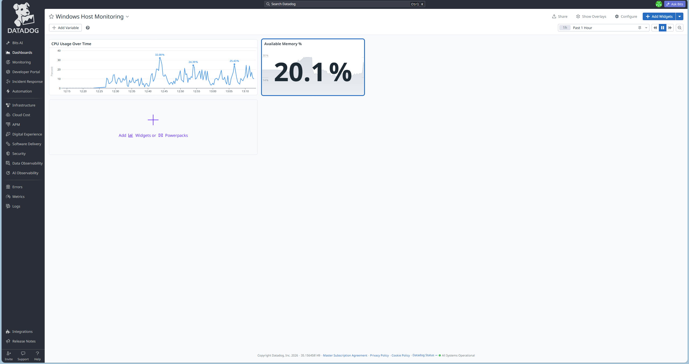
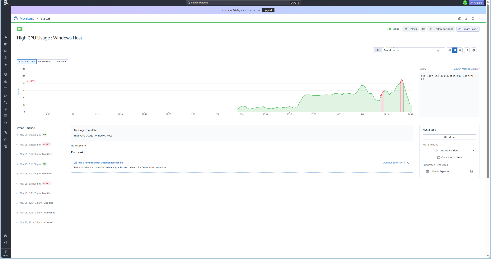

# Datadog Windows Host Monitoring Lab

A hands-on monitoring lab using the **Datadog Agent** deployed on a Windows host. Covers agent installation, metric collection, monitor creation, dashboard visualisation, and alert testing.

------------------------------------------------------------------------------------------------------------------------------------------------------------------------------------------------------------------------

## Objectives

- Deploy the Datadog Agent on a Windows host
- Collect system metrics (CPU and memory)
- Create a threshold-based alert monitor
- Build a live monitoring dashboard
- Generate synthetic load to trigger and validate the alert

------------------------------------------------------------------------------------------------------------------------------------------------------------------------------------------------------------------------

## Environment

|   Component    |                  Detail                            |
|----------------|----------------------------------------------------|
| Host OS        | Windows (physical host running VMware Workstation) |
| Datadog Agent  | v7.86.0-1                                          |
| Datadog Region | EU — uk1.datadoghq.com                             |
| Plan           | Free tier (Log Management not included)            |

------------------------------------------------------------------------------------------------------------------------------------------------------------------------------------------------------------------------

## Lab Steps

### Step 1 - Install the Datadog Agent

Installed the Datadog Agent on the Windows host via the official installer. Post-install verification via PowerShell:

```powershell
# Confirm installation directory
Get-ChildItem "C:\Program Files\Datadog\"

# Confirm service is running
Get-Service | Where-Object {$_.DisplayName -like "*Datadog*"}
```

**Result:** `datadogagent` service confirmed as `Running`.

------------------------------------------------------------------------------------------------------------------------------------------------------------------------------------------------------------------------

### Step 2 - Configure Windows Security Event Log Forwarding (attempted)

Created the config file for Windows Security Event log forwarding:

```powershell
New-Item -ItemType Directory -Path "C:\ProgramData\Datadog\conf.d\win32_event_log.d" -Force

@"
logs:
  - type: windows_event
    channel_path: Security
    source: windows
    service: windows-security
"@ | Out-File -FilePath "C:\ProgramData\Datadog\conf.d\win32_event_log.d\conf.yaml" -Encoding utf8
```

Restarted the agent to apply the config:

```powershell
Restart-Service -Name "datadogagent" -Force
```

> **Note:** Log Management is not available on the Datadog free plan. The lab was pivoted to metrics-based monitoring using `system.cpu.user` and `system.mem.pct_usable` — which better reflects a real production monitoring use case.

------------------------------------------------------------------------------------------------------------------------------------------------------------------------------------------------------------------------

### Step 3 - Create a Monitor (High CPU Alert)

Created a **Metric Monitor** to alert when average CPU usage exceeds the threshold over a 5-minute window.

| Setting         |                 Value                      |
|-----------------|--------------------------------------------|
| Monitor type    | Metric — Threshold Alert                   |
| Query           | `avg(last_5m):avg:system.cpu.user{*} > 80` |
| Alert threshold | > 80%                                      |
| Monitor name    | High CPU Usage : Windows Host              |

**Monitor status: OK (green) - live data flowing from host.**



------------------------------------------------------------------------------------------------------------------------------------------------------------------------------------------------------------------------

### Step 4 - Build the Dashboard

Created a blank dashboard named **Windows Host Monitoring** with two widgets:

**Widget 1 — CPU Timeseries**
- Type: Timeseries
- Metric: `system.cpu.user`
- Title: `CPU Usage Over Time`

**Widget 2 — Available Memory**
- Type: Query Value
- Metric: `system.mem.pct_usable`
- Title: `Available Memory %`



------------------------------------------------------------------------------------------------------------------------------------------------------------------------------------------------------------------------

### Step 5 — Generate Test Data and Trigger Alert

Ran synthetic CPU load using PowerShell background jobs to push usage above the alert threshold:

```powershell
# Spin up CPU-intensive background jobs
1..40 | ForEach-Object { Start-Job { while($true){} } }

# After alert fires, clean up
Get-Job | Stop-Job
Get-Job | Remove-Job
```

**Threshold tuning:** During initial testing, the alert threshold was temporarily lowered to 40% to validate that the alerting pipeline was working end-to-end (agent → Datadog → monitor evaluation → state change). Once confirmed, the threshold was restored to 80%. A subsequent CPU spike then triggered the alert at the full production threshold.

The monitor transitioned from **OK → ALERT** at **14:23 on 25 Nov 2026**, with CPU usage clearly exceeding 80%. The graph shows the full alert lifecycle — spike, alert, and recovery back to OK.



------------------------------------------------------------------------------------------------------------------------------------------------------------------------------------------------------------------------

## Results

|        Deliverable                      | Status |
|-----------------------------------------|--------|
| Datadog Agent installed and running     | ✅    |
| System metrics flowing (CPU + memory)   | ✅    |
| Threshold monitor created               | ✅    |
| Dashboard with two live widgets         | ✅    |
| CPU spike generated and alert triggered | ✅    |

------------------------------------------------------------------------------------------------------------------------------------------------------------------------------------------------------------------------

## Key Takeaways

- **Agent deployment:** The Datadog Agent runs as a Windows service and collects host metrics out of the box with minimal configuration.
- **Monitor tuning:** Alert thresholds should reflect observed baselines, not arbitrary values. The 5-minute average window smooths transient spikes and reduces false positives.
- **Free plan scope:** Log Management (including Windows Security Event log forwarding for Event ID 4625 — failed logons) requires a paid plan. For SIEM use cases, a paid tier or an alternative stack (e.g. Elastic/OpenSearch) would be appropriate.
- **Dashboard visibility:** Combining a timeseries (trend) with a query value (current state) gives both historical context and an at-a-glance health indicator — a standard pattern in real SOC dashboards.

------------------------------------------------------------------------------------------------------------------------------------------------------------------------------------------------------------------------

## Screenshots

Upload your screenshots to a `screenshots/` folder in this repo:

| File                            | Contents                              |
|---------------------------------|---------------------------------------|
| `screenshots/monitor-ok.png`    | Monitor in OK state — live CPU data   |
| `screenshots/dashboard.png`     | Completed dashboard with both widgets |
| `screenshots/monitor-alert.png` | Monitor in ALERT state — CPU spike    |

------------------------------------------------------------------------------------------------------------------------------------------------------------------------------------------------------------------------

## Author

**Andre Patterson** · [github.com/aap-soc](https://github.com/aap-soc)  
CompTIA Security+ · Datadog Agent Deployment · Windows Metrics Monitoring
